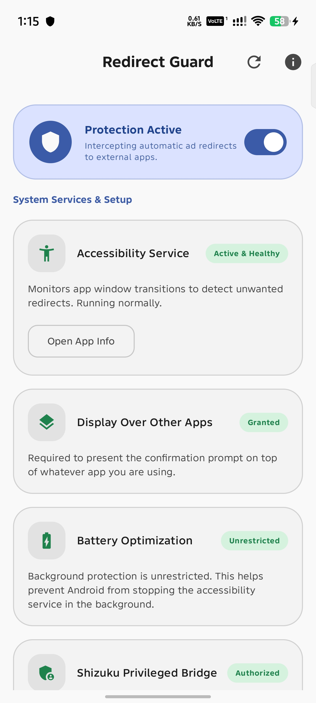
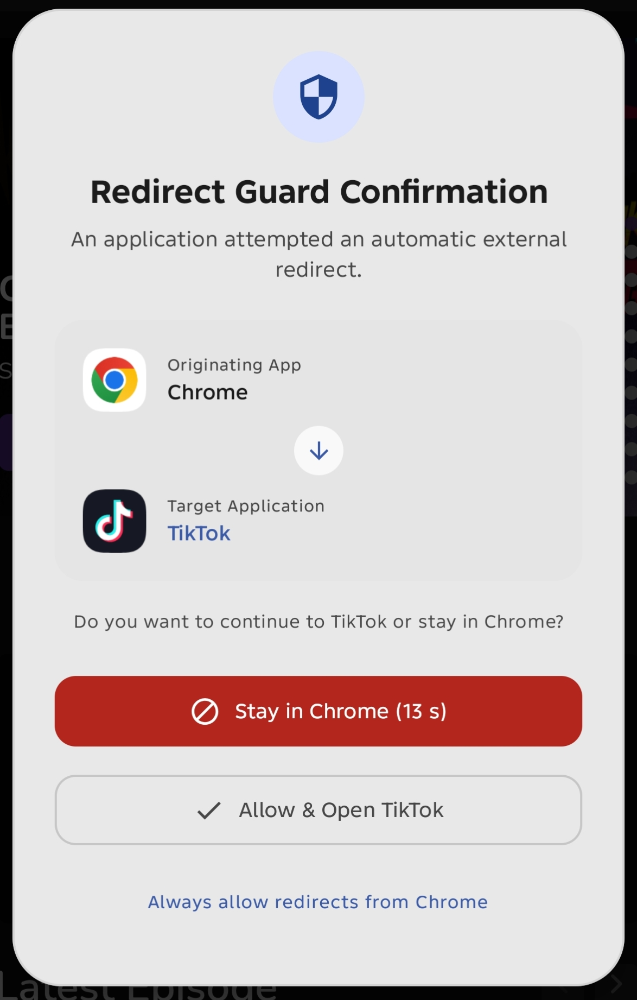
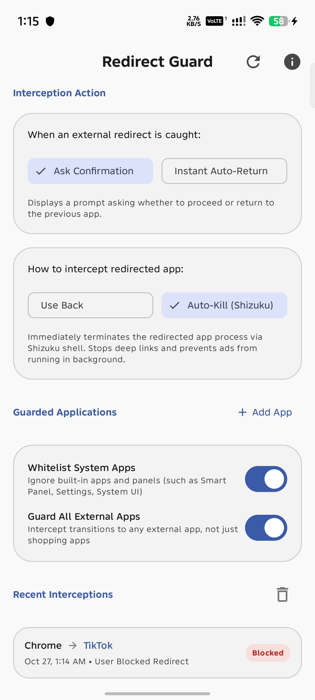

<p align="center">
  
</p>

<h1 align="center">Redirect Guard</h1>

<p align="center">
  <a href="https://android.com"></a>
  <a href="https://github.com/rdevzph/RedirectGuard/releases"></a>
  <a href="https://developer.android.com/about/versions/nougat"></a>
  <a href="https://developer.android.com/about/versions/15"></a>
  <a href="https://kotlinlang.org"></a>
  <a href="https://developer.android.com/jetpack/compose"></a>
  <a href="https://shizuku.rikka.app"></a>
  <a href="LICENSE"></a>
</p>

## Overview

Are you tired of ads instantly redirecting you to apps like Shopee or Lazada without your consent? What if you could use an Android app called Redirect Guard that asks for your permission before opening another app, giving you control over unwanted redirects?

Redirect Guard acts as a safety shield between your apps. When an ad, webpage, or link attempts to force-open an external application or deep link, Redirect Guard catches the redirect and gives you the choice to stay where you are or open the app.

<p align="center">
  
  &nbsp;
  
  &nbsp;
  
</p>

## Features

- **Permission Confirmation Prompt**: Displays an alert asking whether you want to continue to the target app or remain in your current app, complete with a safety countdown timer.
- **Deep Link Interception**: Stops unauthorized deep links from automatically loading before you grant permission.
- **Configurable Interception Strategy**: Choose how Redirect Guard stops unwanted redirects:
  - **Use Back**: Simulates the system Back button to return to your source app without needing root or extra tools.
  - **Auto-Kill via Shizuku**: Force-stops the target app process using Shizuku shell to terminate background tasks and cancel deep links completely.
- **Interception Modes**:
  - **Ask Confirmation**: Shows a prompt with app icons and names so you can confirm or block each redirect.
  - **Instant Auto-Return**: Automatically returns you to your previous app immediately without displaying a prompt.
- **Smart Launcher and System App Whitelist**: Distinguishes between accidental redirects and intentional user actions. Launching apps from your home screen, app drawer, recent apps screen, or system utilities is never blocked.
- **Guarded App Selection**: Guard specific shopping and external apps using built-in presets, or turn on full protection to guard against redirects to any external application.
- **Activity Log**: Keep track of intercepted redirects, showing timestamps, source apps, target apps, and actions taken.
- **Accessibility Service Health Checker**: Automatically detects if Android has killed the background accessibility service and offers one-tap recovery through Shizuku or the App Info screen.

## How It Works

1. **Detection**: Redirect Guard monitors window transitions using Android Accessibility Service.
2. **Analysis**: When a transition to a guarded app occurs, Redirect Guard checks the source. If the launch came from an ad, webpage, or external app rather than your home screen launcher or system UI, it is identified as an unauthorized redirect.
3. **Interception**: Redirect Guard executes your selected action (Back button navigation or Shizuku force stop) to abort deep link execution.
4. **User Choice**: In confirmation mode, a dialog asks if you want to allow the app to open. If you select "Stay in App" or let the timer expire, you remain safely in your original application.

## Permissions

- **Accessibility Service**: Required to detect when apps transition to another application.
- **Display Over Other Apps**: Required to show the confirmation prompt over the originating app.
- **Shizuku (Optional)**: Enables advanced features such as automatic overlay permission granting, accessibility service recovery, battery optimization whitelisting, and process termination for redirected apps.
- **Notifications (Android 13+)**: Required for service status indicators and alerts.
- **Ignore Battery Optimizations (Optional)**: Keeps the background accessibility service running during deep sleep.

## Building and Installation

### Prerequisites

- Android Studio Ladybug or newer
- JDK 17 or newer
- Android SDK with platform 35+

### Build Steps

1. Clone the repository:
   ```bash
   git clone https://github.com/rdevzph/RedirectGuard.git
   ```
2. Open the project in Android Studio or compile using the Gradle wrapper:
   ```bash
   ./gradlew assembleDebug
   ```
3. Install the application on your connected Android device:
   ```bash
   ./gradlew installDebug
   ```

## License

This project is licensed under the Apache License 2.0. See the [LICENSE](LICENSE) file for details.
