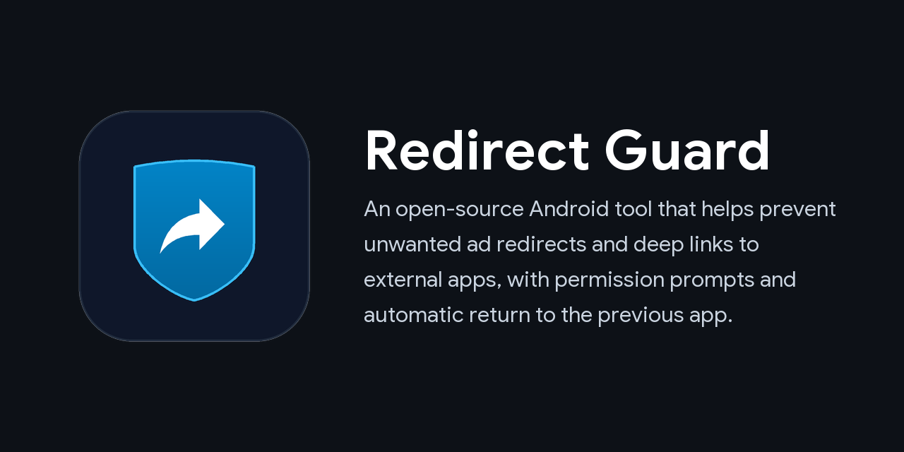
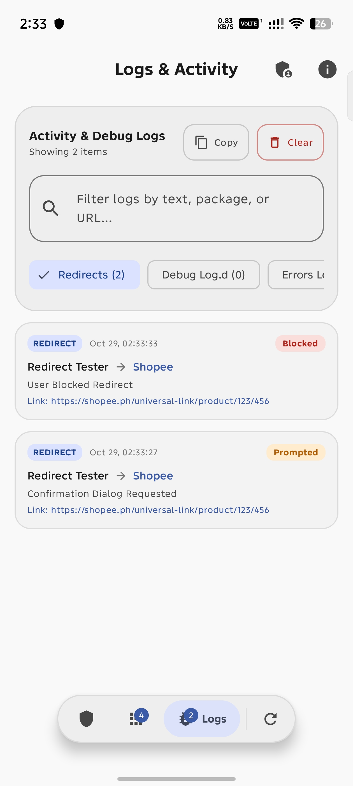

<p align="center">
  
</p>

<h1 align="center">Redirect Guard</h1>

<p align="center">
  <a href="https://android.com"></a>
  <a href="https://github.com/rdevz-ph/RedirectGuard/actions/workflows/android.yml"></a>
  <a href="https://github.com/rdevz-ph/RedirectGuard/releases"></a>
  <a href="https://developer.android.com/about/versions/nougat"></a>
  <a href="https://developer.android.com"></a>
  <a href="https://kotlinlang.org"></a>
  <a href="https://developer.android.com/jetpack/compose"></a>
  <a href="https://shizuku.rikka.app"></a>
  <a href="LICENSE"></a>
</p>

> [!WARNING]
> Redirect Guard uses Android Accessibility Service and Shizuku to detect unwanted app launches and immediately terminate redirected processes. Because Android window detection happens after an app begins to open, a redirected app may briefly appear on screen before being closed. While Redirect Guard includes battery optimization exemptions and health monitoring to stay active, aggressive device-specific battery savers may still restrict background services. Redirect Guard serves as a practical shield against intrusive ad redirects, not as a guaranteed security solution against malware.

## Overview

Are you tired of ads instantly redirecting you to apps like Shopee or Lazada without your consent? What if you could use an Android app called Redirect Guard that asks for your permission before opening another app, giving you control over unwanted redirects?

Redirect Guard acts as a safety shield between your apps. When an ad, webpage, or link attempts to force-open an external application or deep link, Redirect Guard catches the redirect and gives you the choice to stay where you are or open the app.

<p align="center">
  
</p>

| 1 | 2 | 3 | 4 |
| --- | --- | --- | --- |
|  |  |  |  |

## Download

<p align="center">
  <a href="https://github.com/rdevz-ph/RedirectGuard/releases/latest"></a>
  <a href="https://awesome-shizuku.vercel.app/apps/redirectguard"></a>
</p>

> [!TIP]
> **Want to test or verify the app functionality?**
> Please use **Redirect Tester** (`RedirectGuardTester-*-release.zip`): An optional companion tool packaged as a ZIP archive to prevent app store indexers from mistaking it for the main app. Extract the ZIP to install the companion tester APK and verify Redirect Guard safely.

## Features

- **Dedicated Setup Wizard**: Guides first-time setup with an interactive checklist to verify requirements before entering the main dashboard, with one-tap configuration via Shizuku.
- **Permission Confirmation Prompt**: Displays an alert asking whether you want to continue to the target app or remain in your current app, complete with a safety countdown timer.
- **Deep Link Interception**: Stops unauthorized deep links from automatically loading before you grant permission.
- **Process Termination via Shizuku**: Force-stops the target app process using Shizuku shell to terminate background tasks and cancel deep links completely.
- **Interception Modes**:
  - **Ask Confirmation**: Shows a prompt with app icons and names so you can confirm or block each redirect.
  - **Instant Auto-Return**: Automatically terminates the redirected app immediately without displaying a prompt.
- **Smart Launcher and System App Whitelist**: Distinguishes between accidental redirects and intentional user actions. Launching apps from your home screen, app drawer, recent apps screen, or system utilities is never blocked.
- **Dedicated Applications Management**: Search, filter, and customize guard and whitelist settings for individual user and system applications, complete with automatic preset restoration and conflict prevention.
- **Guarded App Selection**: Guard specific shopping and external apps using built-in presets, or turn on full protection to guard against redirects to any external application.
- **Activity Log**: Keep track of intercepted redirects, showing timestamps, source apps, target apps, and actions taken.
- **Accessibility Service Health Checker**: Automatically detects if Android has stopped or desynced the background accessibility service, allowing you to force stop the app to clear stuck states, enable it with one tap through Shizuku, or open system accessibility settings directly.

## How It Works

1. **Detection**: Redirect Guard monitors window transitions using Android Accessibility Service.
2. **Analysis**: When a transition to a guarded app occurs, Redirect Guard checks the source. If the launch came from an ad, webpage, or external app rather than your home screen launcher or system UI, it is identified as an unauthorized redirect.
3. **Interception**: Redirect Guard terminates the target app process using Shizuku shell to abort deep link execution.
4. **User Choice**: In confirmation mode, a dialog asks if you want to allow the app to open. If you select "Stay in App" or let the timer expire, you remain safely in your original application.

## Prerequisites and Permissions

- **Accessibility Service (Required)**: Needed to detect when apps transition to another application.
- **Shizuku (Required)**: Needed to terminate redirected apps and stop persistent deep links.
- **Display Over Other Apps (Required)**: Needed to show the confirmation prompt over the originating app.
- **Notifications (Android 13+)**: Required for service status indicators and alerts.
- **Ignore Battery Optimizations (Optional)**: Helps prevent Android from stopping the background accessibility service.

## Building and Installation

### Prerequisites

- Android Studio Ladybug or newer
- JDK 17 or newer
- Android SDK with platform 37

### Build Steps

1. Clone the repository:
   ```bash
   git clone https://github.com/rdevz-ph/RedirectGuard.git
   ```
2. Open the project in Android Studio or compile using the Gradle wrapper:
   ```bash
   ./gradlew assembleDebug
   ```
3. Install the application on your connected Android device:
   ```bash
   ./gradlew installDebug
   ```

### Building the Tester Companion App

The repository includes an optional companion app in the `:tester` module. It allows you to test Redirect Guard safely without needing to visit ad-heavy websites or trigger accidental app redirects.

The tester companion app allows you to:
- Test redirects to common shopping apps (Shopee, Lazada, TikTok, and Amazon) using both web URLs and custom app schemes.
- Run a 3-second delayed ad simulator to test background detection.
- Check if Redirect Guard is installed and whether its accessibility service is active.
- Test custom deep links and package intents.

To compile and install the tester companion app:

1. Build the tester debug APK:
   ```bash
   ./gradlew :tester:assembleDebug
   ```
2. Or install it directly on your connected device:
   ```bash
   ./gradlew :tester:installDebug
   ```

## Privacy Policy

Redirect Guard for Android operates completely offline. It does not collect, monitor, or transmit any personal data. You can read the full policy at [Privacy Policy](https://rdevz-ph.github.io/RedirectGuard/privacy.html).

## License

This project is licensed under the Apache License 2.0. See the [LICENSE](LICENSE) file for details.
